A prototype is not the product. I take AI and SaaS products from demo to production for startups
and agencies: RAG, AI agents, the platform underneath and the hardening that keeps it running.
I have been shipping software since 2017, and since 2022 I run
**[Apex36 Technologies](https://apex36tech.com)** from Mumbai, with clients in the US, UK and Germany.

|  **9+ years** shipping  |  **12+ products** across 7 industries  |  **10-engineer** DevOps CoE led  |  **US · UK · DE** clients  |
|:---:|:---:|:---:|:---:|

## ✦ Featured work

  
  
  

## ✦ Products we run at Apex36

| | Product | What it does |
|:---:|---|---|
| 🎨 | **[BrandGen](https://getbrandgen.com)** | Brand-aligned AI image and content generation. Live since January 2026. |
| 📞 | **Convo AI** | Inbound AI voice assistant. |
| 🔑 | **[CC Logins](https://github.com/yashsoni369/cc-logins)** | Apex36's first open-source product: a tray app for people who run Claude Code on more than one account. |

## ✦ Built for clients

| | Work | What I built | Result |
|:---:|---|---|---|
| ⚖️ | **DecoverAI** | AI document search for US law firms: RAG on Pinecone and MongoDB, running on EKS | In use at **10+ US law firms**, built over 13 months |
| 🎓 | **AI avatar language app** | Avatar-led language practice for UK schools | **10+ UK schools** in the first 3 months |
| 🧩 | **[Mappie AI](https://mappie.ai)** | Turns requirements into dev-ready user stories | Live product |
| 📊 | **Vectro AI** | Sales intelligence from calls, email and Slack, on vector search | Shipped |
| 🚗 | **US electric-vehicle manufacturer** | Serverless AWS automation feeding SAP and Coupa workflows | Shipped |
| 🔧 | **Infinity DevOps** at LTIMindtree | Tech lead on an internal DevOps platform | Led a **10-engineer** Center of Excellence across AWS and GCP |

## ✦ Open source

- **[wavect/semaprax](https://github.com/wavect/semaprax/pulls?q=is%3Apr+author%3Ayashsoni369+is%3Amerged)**: 7 merged PRs in an agent-native systems language written in Rust. I measured how often one authoring mistake produced several errors (14 of 60 probes) and fixed the verifier so it reports one; I also repaired failing grammar, clippy and test gates.
- **[ThatOneCheat/list-coding-agents](https://github.com/ThatOneCheat/list-coding-agents/pull/3)**: faster version probe, fewer false positives, tests and CI.
- **[cc-logins](https://github.com/yashsoni369/cc-logins)**: Rust and Tauri 2, MIT licensed.
- **[CricketCommander](https://github.com/yashsoni369/criccommander)**: three Gemini agents (a statistician, a Hinglish hype-man and a predictor) react to every ball of a live IPL match. Built at GDG's Agentic Premier League hackathon in Mumbai.

## ✦ Stack

   
   
  

  <b>AI:</b> RAG pipelines · vector search · agents and tool use · voice AI · document AI · OpenAI · Claude · Gemini · Hugging Face

## ✦ Activity

<picture>
  <source media="(prefers-color-scheme: dark)" srcset="https://raw.githubusercontent.com/yashsoni369/yashsoni369/output/snake-dark.svg" />
  <source media="(prefers-color-scheme: light)" srcset="https://raw.githubusercontent.com/yashsoni369/yashsoni369/output/snake-light.svg" />
  
</picture>

**Have a prototype that needs to become a product?**

